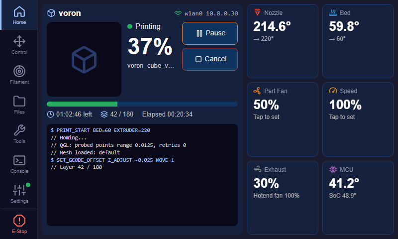
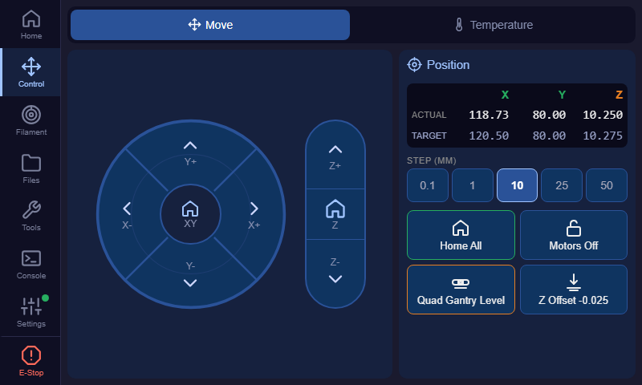
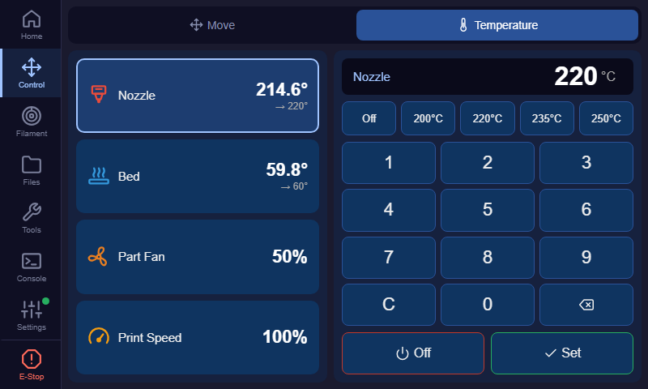
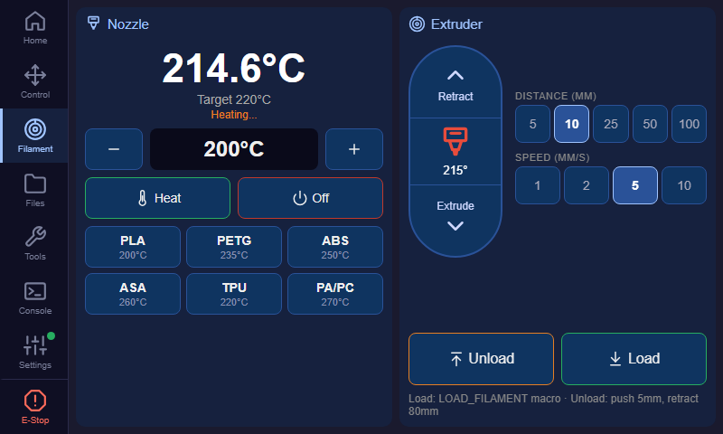
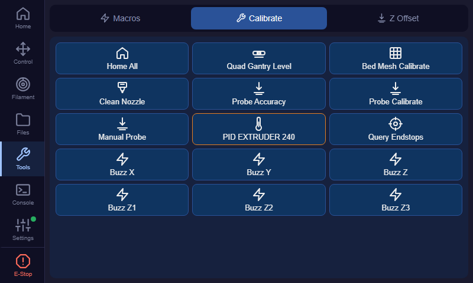
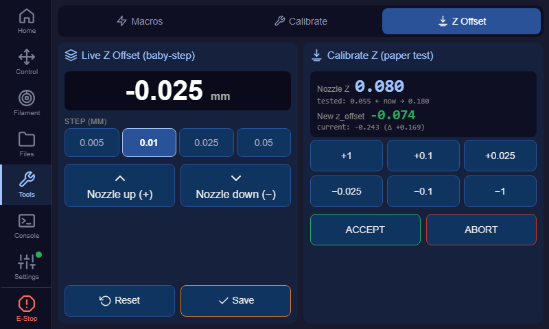
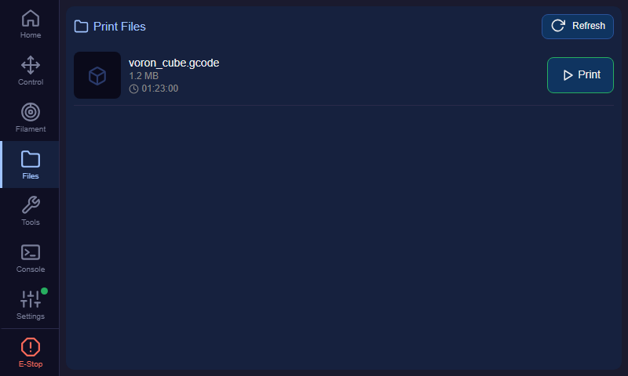
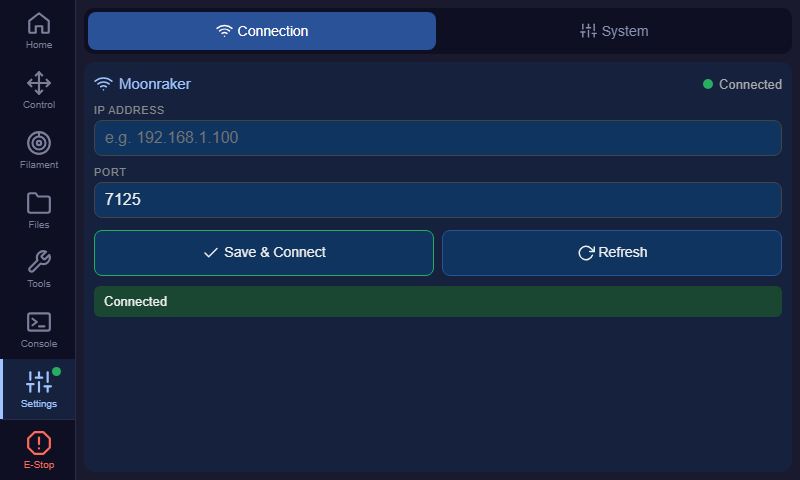

# simple3D — Klipper Touch UI for 7" Screens and Legacy Devices

A minimal, single-file web UI for controlling a Klipper 3D printer through the Moonraker API.

It is built for **small touchscreens (7", 800×480 to 1024×600)** and **old browsers such as iOS 10 Safari**, which can't run Fluidd or Mainsail. The layout borrows from KlipperScreen and the Bambu Lab printer screen: a sidebar to pick a page, and tabs to switch between a page's sub-pages.

There are no build tools, no npm, and no framework. The whole app is one `index.html` file.

## Screenshots

> These screenshots use demo data and were captured at 800×480. Part thumbnails appear when your slicer embeds them in the G-code.

| Home | Control › Move |
|---|---|
|  |  |

| Control › Temperature | Filament |
|---|---|
|  |  |

| Tools › Calibrate | Tools › Z Offset |
|---|---|
|  |  |

| Files | Settings |
|---|---|
|  |  |

## Features

- **One screen per page.** Each page fits the screen without scrolling; only long lists scroll inside their panel.
- **Sidebar navigation** with icons, a connection indicator, and an **E-Stop** button.
- **Home:** printer name and Wi-Fi/LAN address, part thumbnail, progress, time left, layer, filament used, and a live **console preview** (auto-scrolls; tap it to open the Console). Also Pause / Resume / Cancel / Reprint and live tiles for nozzle, bed, fans, speed, MCU and SoC.
- **Control › Move:**
  - Joystick-style X/Y pad and a separate Z column.
  - Step size from 0.1 to 50 mm.
  - **Actual / Target** position, like Mainsail and Fluidd.
  - Home All, Motors Off, **Quad Gantry Level**, Z Tilt, and a shortcut to Z Offset.
- **Control › Temperature:** choose nozzle, bed, part fan or print speed, then use presets or an on-screen keypad. No keyboard pops up.
- **Filament (Bambu style):**
  - Nozzle temperature with −/+ buttons and material presets (PLA, PETG, ABS, ASA, TPU, PA).
  - Extrude / Retract with adjustable distance and speed.
  - **Load / Unload** run your `LOAD_FILAMENT` / `UNLOAD_FILAMENT` macros when they exist, and fall back to plain G-code otherwise.
- **Files:** G-code list with thumbnails, estimated time and filament length.
- **Tools:**
  - Macros: every visible `gcode_macro`.
  - Calibrate: QGL, Z tilt, bed mesh, probe accuracy and calibrate, PID macros, endstops, stepper buzz.
  - Z Offset: live baby-stepping during a print, plus the paper-test calibration.
- **Console:** G-code log with command history and a **Macros** picker page (filter, descriptions, Insert to add parameters, or Run).
- **Settings:** Moonraker connection, Firmware Restart, Restart Klipper, and an **Update** tab. It lists simple3D, **Klipper**, **Moonraker**, **System (OS packages)** and any other software Moonraker tracks, each with its own Update button, plus Update all. Updates are disabled while printing.
- **Print lock:** while a print runs, the Move, Extruder, Macros and Calibrate controls are disabled. Pause, Cancel and Z Offset stay usable.
- **Live data** comes over the Moonraker WebSocket.

## Requirements

- Klipper + Moonraker running on your printer's board (e.g. BTT CB1, Raspberry Pi).
- Python 3 on the board (pre-installed on most Klipper images).
- A browser on the same network: a 7" touchscreen, a tablet, or an old iPad/iPhone.

## Installation on the Printer

SSH into the board, then:

```bash
git clone https://github.com/yohannaftali/simple3D.git ~/simple3D
cd ~/simple3D
chmod +x install_service.sh
./install_service.sh
```

This installs the `simple3d` systemd service. It runs `python3 -m http.server 8080` in `~/simple3D` and starts on every boot.

> `simple3d.service` assumes the user is `biqu` (BTT CB1). On a Raspberry Pi or another image, change `User=` and `WorkingDirectory=` first, for example to `pi` and `/home/pi/simple3D`.

Then open the UI from any browser on your local network:

```
http://<your-board-ip>:8080
```

## Usage

### First run
1. Open `http://<board-ip>:8080`. With no printer saved yet, it opens on **Settings › Connection**.
2. Enter the Moonraker IP (usually the board's IP) and port (default `7125`).
3. Tap **Save & Connect**. The dot on the Settings icon turns green once connected.

The settings are saved in the browser, so each device only needs this once.

### Everyday use
| To… | Go to |
|---|---|
| Watch or control a print | **Home**. Tap a temperature or fan tile to change it. |
| Home, jog or level the gantry | **Control › Move** |
| Set nozzle / bed temperature, fan or speed | **Control › Temperature**. Tap a row, then a preset or type on the keypad and tap **Set**. |
| Change filament | **Filament**. Heat the nozzle with a preset, then **Unload** / **Load**. |
| Start a print | **Files › Print** |
| Adjust the first layer while printing | **Tools › Z Offset**. Use Nozzle up/down, then **Save** after the print. |
| Calibrate Z offset (paper test) | **Tools › Z Offset**, then PROBE_CALIBRATE or Z_ENDSTOP_CALIBRATE |
| Run a macro | **Tools › Macros** |
| Run a macro with parameters | **Console › Macros**, then **Insert**, type the parameters, and **Send** |
| Recover after an E-Stop | **Settings › System › Firmware Restart** |
| Update simple3D, Klipper, Moonraker or OS packages | **Settings › Update**, then **Check** and **Update** on a row (or **Update all**) |

### Optional printer setup
- **Thumbnails:** turn on G-code thumbnails in your slicer (e.g. `300x300`) for the Home and Files pictures.
- **Layer counter:** have your slicer or start macro call `SET_PRINT_STATS_INFO TOTAL_LAYER=…` and `CURRENT_LAYER=…`.
- **Load / Unload:** define `LOAD_FILAMENT` / `UNLOAD_FILAMENT` macros to control exactly how filament is changed.
- **Printer name:** Home shows the name set in Fluidd (*Settings › General › Printer name*) or Mainsail; otherwise the board's hostname.
- **Temperature/fan tiles:** the MCU, SoC, exhaust and hotend fan tiles read `temperature_sensor MCU`, `temperature_sensor SoC`, `fan_generic exhaust_fan` and `heater_fan hotend_fan`. Rename them in `WS_OBJECTS` inside `index.html` if your config uses other names.

### Kiosk tip (iOS)
In Safari, tap **Share › Add to Home Screen** to open the UI full-screen without the browser bars.

## Updating from the UI

**Settings › Update** lists everything Moonraker's update manager tracks: simple3D, Klipper, Moonraker, System (OS packages), and any other entries such as Fluidd or KlipperScreen.
- Each row shows the installed version and a badge (*Up to date*, *N new*, *N packages*, *Modified*). Tap a row to see the new commits or packages.
- **Update** updates that item. **Update all** does everything. **Repair** appears when a repo has local changes.
- After updating simple3D, the page reloads by itself.
- Updates are disabled while a print is running.

Klipper, Moonraker and System work out of the box. For **simple3D itself** (a git pull from `main`), Moonraker needs a one-time setup on the printer, because the browser can't run `git`:

1. `~/simple3D` must be a git clone, as created by the Installation steps above. If you deployed with `scp` before, convert it:
   ```bash
   cd ~/simple3D
   git init -b main
   git remote add origin https://github.com/yohannaftali/simple3D.git
   git fetch origin main
   git reset --hard origin/main
   git branch -u origin/main
   ```
2. Add this to `~/printer_data/config/moonraker.conf`:
   ```ini
   [update_manager simple3d]
   type: git_repo
   path: ~/simple3D
   origin: https://github.com/yohannaftali/simple3D.git
   primary_branch: main
   is_system_service: False
   ```
3. Restart Moonraker: `sudo systemctl restart moonraker`.

simple3D then also appears in Fluidd/Mainsail's update list. Moonraker refuses updates while a print is running.

> If you copy files with `scp` into a git-managed `~/simple3D`, Moonraker reports the repo as *dirty* and blocks updates. Tap **Reset to main** to discard the local copy, or push your change to GitHub and update instead.

## Deploying Changes to the Machine

The service serves files statically, so **no restart is needed**. Copy the new `index.html` and reload the browser.

**From a dev machine** (Windows PowerShell, macOS or Linux), with an SSH alias such as `voron` set up in `~/.ssh/config`:

```powershell
scp index.html voron:~/simple3D/
```

To check that the deployed file matches your local copy:

```bash
ssh voron "md5sum ~/simple3D/index.html"   # compare with your local hash
```

**If the board has a git clone of the repo:**

```bash
cd ~/simple3D
git pull
```

If a screen still shows the old version after deploying, reload the page. Some old browsers cache aggressively.

## Service Management

```bash
sudo systemctl status simple3d     # check status
sudo systemctl restart simple3d    # restart
sudo systemctl stop simple3d       # stop
sudo systemctl disable simple3d    # disable autostart
```

### Manual run (without the service)

```bash
cd ~/simple3D
python3 -m http.server 8080
```

## File Structure

```
simple3D/
├── index.html            # entire application (single file)
├── simple3d.service      # systemd service definition
├── install_service.sh    # installer script
├── docs/screenshots/     # README images
├── CHANGE_HISTORY.md     # implementation notes per phase
└── README.md
```

## Compatibility

- 7" touchscreens in landscape (800×480, 1024×600); portrait also works and scrolls.
- iOS 10 Safari and other legacy WebKit browsers.
- Modern Chrome, Firefox, Safari and Edge.

The code is plain ES5 JavaScript (no `let`/`const`, arrow functions, `fetch` or Promises) and uses `-webkit-` prefixed flexbox (no CSS grid). Icons are inline SVG, so nothing loads from the internet.

## License

MIT
